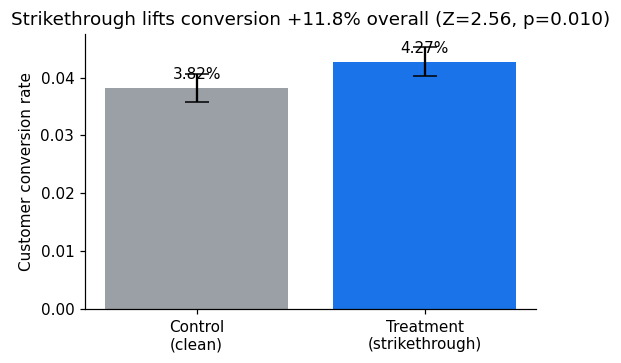
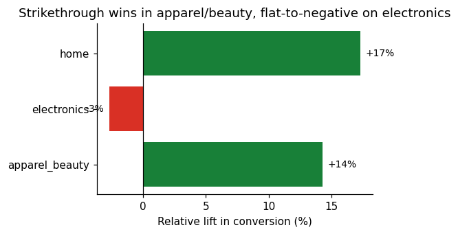

# Does strikethrough pricing actually lift conversion? — an A/B test

`Python` · `SQL (DuckDB / Postgres)` · `scipy` · `statsmodels` · `pandas` · `matplotlib`

> **The question.** Showing a struck-through MRP and a "Save X%" badge on the product page — does it lift conversion, or just pull in deal-seekers who return more and don't come back? Merchandising and brand teams argue about this constantly; almost nobody settles it on data.
>
> **The answer (this study).** It lifts conversion **+11.8% overall** (Z = 2.56, p = 0.011, 95% CI +2.8%…+20.9%) — but the win is **concentrated in apparel/beauty (+14%)**, is **flat-to-negative on electronics (−3%)**, and **roughly doubles the refund rate**. So the right decision isn't "ship it" or "kill it" — it's **ship it by category**.

End-to-end: pre-registered design → randomization → validity checks → inference → a one-page decision memo. **Runs on a fresh clone in ~30 seconds, no database access required.**

**Jump to the good parts:** [📝 Decision memo](decision_memo.md) (2-min read) · [📊 Executed analysis](analysis/analysis.ipynb) · [🧪 Design rationale](DESIGN.md) · [🔒 Pre-registration](PRE_REGISTRATION.md)

---

## Result at a glance

| | Control (clean price) | Treatment (strikethrough) | |
|---|---|---|---|
| Customers | 25,047 | 24,953 | |
| **Conversion** | 3.82% | **4.27%** | **+11.8%** rel · Z=2.56 · p=0.011 |
| Refund rate | 1.04% | 2.06% | ⚠ ~doubles |
| 30-day repeat | 22.6% | 19.0% | ⚠ −3.5pp |
| AOV | ₹2,927 | ₹2,693 | smaller baskets |




The overall lift is real but **concentrated**, and it carries a quality-of-revenue cost — which is exactly why a single global decision would be wrong. Full reasoning and rollout in the [decision memo](decision_memo.md).

## What this project demonstrates

- **Experiment design from first principles** — one decision-gating metric, explicit guardrails, an MDE derived from business economics, and a pre-registration locked *before* any data.
- **Correct causal inference** — randomization at the **customer** (unit of analysis matches unit of randomization), a two-proportion z-test, absolute **and** relative lift with 95% CIs, and a power/MDE reality-check.
- **The senior moves most analyses skip** — **SRM checked before any result is read**, ITT-vs-ATT exposure, **Bonferroni** correction across segment tests, and a correct distinction between **heterogeneity and Simpson's paradox**.
- **Statistics → a decision** — a VP-style memo that recommends ship/hold *by segment* with a refund-rate rollback trigger, not a p-value dump.
- **Reproducible engineering** — a deterministic seed, a test suite that pins the math (cross-checked against `statsmodels`), and a notebook that executes top-to-bottom.

## Run it

```bash
pip install -r requirements.txt
python seed_experiment.py        # deterministic dataset → data/experiment.duckdb (+ CSVs)
pytest -q                        # 7 checks: stats correctness + assignment determinism
jupyter nbconvert --to notebook --execute analysis/analysis.ipynb --inplace
```

The notebook renders inline on GitHub with its figures and numbers — you can read the whole analysis without running anything.

## Repo tour

```
PRE_REGISTRATION.md     design + decision rules, locked before data (the trust anchor)
seed_experiment.py      deterministic data generator (SHA256 assignment, Bernoulli outcomes)
sql/                    01 SRM · 02 exposure (ITT/ATT) · 03 per-variant metrics · 04 segmentation
analysis/
  analysis.ipynb        the executed read-out — figures + numbers inline
  stats.py              z-test, lift+CI, SRM, Bonferroni, power — small and auditable
tests/test_stats.py     7 pytest checks (incl. cross-check vs statsmodels; Z in a sane range)
decision_memo.md        the one-page recommendation to a VP of Product
DESIGN.md               why each design + statistical choice was made
figures/                charts used above
```

## Methodology highlights

Full write-up in [DESIGN.md](DESIGN.md). The decisions that matter most:

- **Why customer-level, not session-level:** sessions from one user are correlated; analysing per-session underestimates variance and inflates false positives. The analysis unit must match the randomization unit.
- **Why the MDE comes from economics, not gut feel:** the change is cheap to build, so the bar isn't break-even — it's being confident the effect clears the guardrail risk. That choice sizes the test.
- **Why SRM runs first:** if the 50/50 split didn't hold, randomization is broken and every downstream number is suspect. It's the first cell in the notebook, before any conversion figure.
- **Why segmentation needs Bonferroni:** nine segment tests at α=0.05 would expect ~1 false positive by chance; the correction (α≈0.006) is what lets the apparel/beauty result be trusted.

## The data

The dataset is **synthetic but realistic**, produced by `seed_experiment.py` — a deliberate engineering choice so the entire analysis is **reproducible by anyone** (clone and run) with no warehouse credentials. The baseline (3.9%) and the effect band (+3–12% relative — what strikethrough pricing actually produces) are calibrated to real e-commerce behaviour, and the heterogeneity (fashion responds to discount framing, premium electronics doesn't) mirrors a well-documented merchandising pattern. The SQL is standard and **ports directly to a production Postgres warehouse** — each file documents the mapping (event stream for exposure, an order-refunds view, customer/session/device joins for segments).

## Limitations

- **Synthetic data** — the *method* is the deliverable, not the exact lift; on production data you'd re-confirm the baseline and the category split, which can move the per-segment verdicts.
- **Novelty effect** — a 28-day window can overstate the long-run lift by ~10–20%; the memo schedules a 90-day re-read.
- **Repeat-rate signal is early** at a 30-day window — directional, not yet settled.
- **Cross-device** — ~5–10% of users may see mixed variants (anonymous→login); this dilutes the measured effect (conservative).
- **CUPED** variance reduction is noted but not implemented — the pre-period covariate is in the data if you want to add it.

---

*A self-directed analysis demonstrating end-to-end experimentation practice on an e-commerce dataset.*

**Résumé line:** Designed and analysed a customer-level A/B test on PDP discount framing (n ≈ 50k, 28-day run): pre-registered design, SHA256 randomization, SRM + ITT/ATT validity checks, two-proportion z-test with 95% CIs, and Bonferroni-corrected segmentation — found a +11.8% conversion lift concentrated in apparel/beauty (flat-to-negative on electronics) against a doubled refund rate, and shipped a segment-specific rollout via a VP decision memo.
