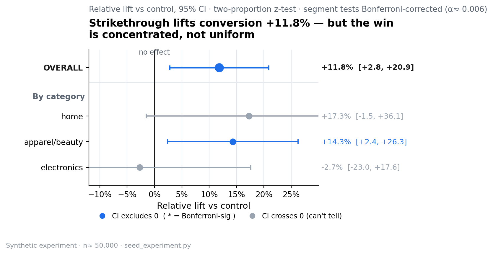
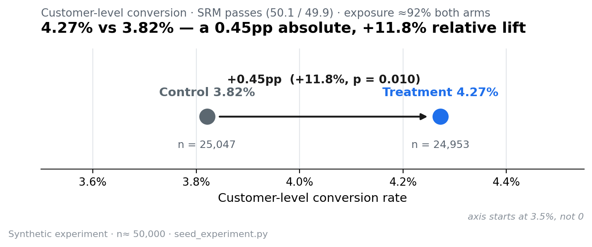
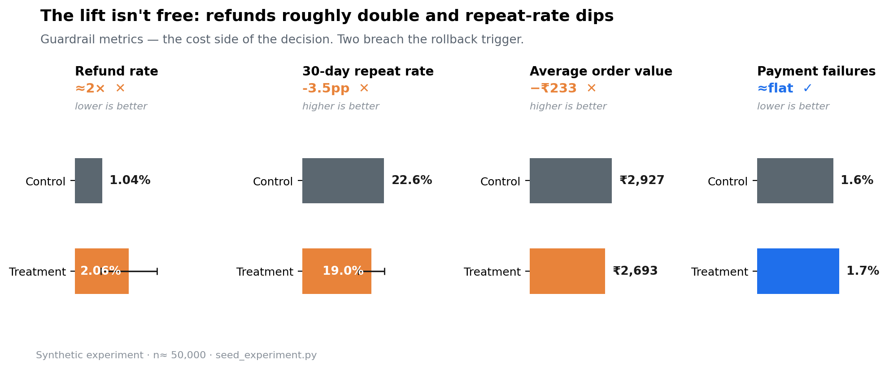

# Does strikethrough pricing actually lift conversion? — an A/B test

> **Strikethrough pricing lifts conversion +11.8% (p = 0.010) — but it breaches our pre-registered refund guardrail and no single category survives multiple-comparison correction. So the rigorous call isn't "ship it." It's a monitored, apparel-only confirmatory rollout — respecting the guardrails we committed to before we saw the data.**

`Python` · `SQL (DuckDB / Postgres)` · `scipy` · `statsmodels` · `pandas` · `matplotlib`

End-to-end: pre-registered design → randomization → validity checks → inference → a one-page decision memo. **Runs on a fresh clone in ~30 seconds, no database access required.**

**Jump to the good parts:** [📝 Decision memo](decision_memo.md) (2-min read) · [📊 Executed analysis](analysis/analysis.ipynb) · [🧪 Design rationale](DESIGN.md) · [🔒 Pre-registration](PRE_REGISTRATION.md)

---

## Result at a glance

| | Control (clean price) | Treatment (strikethrough) | |
|---|---|---|---|
| Customers | 25,047 | 24,953 | |
| **Conversion** | 3.82% | **4.27%** | **+11.8%** rel · Z = 2.56 · **p = 0.010** |
| Refund rate | 1.04% | 2.06% | ⚠ ~doubles — **breaches guardrail** |
| 30-day repeat | 22.6% | 19.0% | ⚠ −3.5pp — **breaches guardrail** |
| AOV | ₹2,927 | ₹2,693 | smaller baskets |

Three pictures, three beats of the story: the top-line lift is real and its CI clears zero (1); it lives in apparel/beauty and reverses on electronics — though no single segment survives Bonferroni, so this is a *direction*, not a proof (2); and it isn't free conversion — two guardrails breach the line we drew in advance (3).

<p align="center">
  
</p>

<p align="center">
  
</p>

<p align="center">
  
</p>

## The decision

**Don't ship globally — and don't kill it.** The primary metric won, but our pre-registered rule says a guardrail breach blocks an unconditional ship, and no category clears the multiple-comparison bar on its own. So:

- **Run a monitored confirmatory rollout to apparel/beauty only** — the segment where the overall lift concentrates and whose CI clears zero — instrumented with a refund kill-switch (**pause if refund rate > 3.0% sustained 3+ days**). The rollout doubles as the experiment that confirms both the lift *and* its refund cost.
- **Hold home** (positive point estimate, but its CI crosses zero — underpowered) and **keep electronics on clean pricing** (no gain, worse guardrails — shipping there would cost margin twice).

The headline isn't the p-value. It's that a real top-line win can still be one your own guardrails won't let you bank yet — and that catching it is the job. Full reasoning, money sizing, and rollback plan in the [decision memo](decision_memo.md).

## What makes this rigorous

- **Designed before data.** Metric, MDE, decision rule, and stopping rule were locked in [pre-registration](PRE_REGISTRATION.md) before a row was collected — so the read-out can't be reverse-fit, and the guardrail breach can't be quietly explained away.
- **Validity before results.** SRM is checked first; ITT is the decision denominator with ATT reported alongside; segment tests carry a Bonferroni correction (α ≈ 0.006 over 9 tests) — which is exactly what stops the suggestive apparel/beauty result from being oversold.
- **Statistics that end in a decision.** A ship/hold/monitor recommendation with a quantified rollback trigger and rough money sizing — not a p-value dump — and one that holds the line on a pre-committed guardrail rather than overriding it to claim a win.

## Run it

```bash
pip install -r requirements.txt
python seed_experiment.py        # deterministic dataset → data/experiment.duckdb (+ CSVs)
python make_figures.py           # renders the 3 figures above from the data
pytest -q                        # 7 checks: stats correctness (vs statsmodels) + assignment determinism
jupyter nbconvert --to notebook --execute analysis/analysis.ipynb --inplace
```

Every number on every chart is computed from the data (nothing hand-typed), and the notebook renders inline on GitHub — you can read the whole analysis without running anything.

## Repo tour

```
PRE_REGISTRATION.md     design + decision rules, locked before data (the trust anchor)
seed_experiment.py      deterministic data generator (SHA256 assignment, Bernoulli outcomes)
make_figures.py         renders the 3 README figures from the data (shared design system)
sql/                    01 SRM · 02 exposure (ITT/ATT) · 03 per-variant metrics (ITT) · 04 segmentation
analysis/
  analysis.ipynb        the executed read-out — SRM, lift+CI, segmentation, peeking simulation, verdict
  stats.py              z-test, lift+CI, SRM, Bonferroni, power — small and auditable
tests/test_stats.py     7 pytest checks (cross-checked vs statsmodels; Z-magnitude sanity; assignment determinism)
decision_memo.md        the one-page recommendation to a VP of Product
DESIGN.md               why each design + statistical choice was made
figures/                charts used above
```

## Methodology highlights

Full write-up in [DESIGN.md](DESIGN.md). The decisions that matter most:

- **Windowing:** 28-day enrollment, **7-day per-customer attribution** — a customer is credited a conversion if they place ≥1 paid order within 7 days of *their own* assignment; the 28-day cap limits novelty inflation.
- **Customer-level, not session-level:** sessions from one user are correlated; analysing per-session underestimates variance and inflates false positives. The analysis unit must match the randomization unit.
- **MDE from economics, not gut feel:** the change is cheap to build, so the bar isn't break-even — it's being confident the effect clears the *guardrail* risk. That choice sizes the test.
- **SRM first:** if the 50/50 split didn't hold, randomization is broken and every downstream number is suspect. It's the first cell in the notebook, before any conversion figure.
- **No peeking — and why:** the notebook simulates it (1,000 null experiments with interim looks push the false-positive rate from ~5% to ~10%). A legitimate mid-flight read needs an alpha-spending design (mSPRT / O'Brien–Fleming), not an ad-hoc look.

## The data

The dataset is **synthetic but realistic**, produced by `seed_experiment.py` — a deliberate engineering choice so the entire analysis is **reproducible by anyone** (clone and run) with no warehouse credentials. The baseline (3.9%) and the effect band (+3–12% relative — what strikethrough pricing actually produces) are calibrated to real e-commerce behaviour, and the heterogeneity (fashion responds to discount framing, premium electronics doesn't) mirrors a documented merchandising pattern. The SQL is standard and **ports directly to a production Postgres warehouse** — each file documents the mapping (event stream for exposure, an order-refunds view, customer/category/device joins for segments).

## Limitations

- **Synthetic data** — the *method* is the deliverable, not the exact lift; on production data you'd re-confirm the baseline and the category split, which can move the per-segment verdicts.
- **Segments are underpowered** — the experiment is sized for the overall effect; no single category survives Bonferroni, which is why the segment story drives a *confirmatory* rollout, not an immediate per-segment ship.
- **Novelty effect** — a discount frame can inflate early lift; the 28-day cap limits this and the memo schedules a 90-day re-read.
- **Repeat-rate signal is early** at a 30-day window — directional; confirm at 60–90 days before treating brand-erosion as settled.
- **CUPED considered, not applied** — with a ~4% binary primary and a near-uncorrelated pre-period covariate, CUPED buys almost nothing here; it earns its keep on continuous metrics, so dressing it up would be theatre (noted in [DESIGN.md](DESIGN.md)).

---

*A self-directed analysis demonstrating end-to-end experimentation practice on an e-commerce dataset.*

**Résumé line:**

> Designed and analysed a customer-level A/B test on PDP discount framing (n ≈ 50k, 28-day enrollment / 7-day attribution): pre-registered design, SHA256 randomization, SRM + ITT/ATT validity checks, two-proportion z-test with 95% CIs, and Bonferroni-corrected segmentation.
>
> Found a +11.8% conversion lift that breached a pre-registered refund guardrail, and — rather than override the rule — recommended a monitored, single-segment confirmatory rollout with a refund-rate rollback trigger via a VP decision memo.
